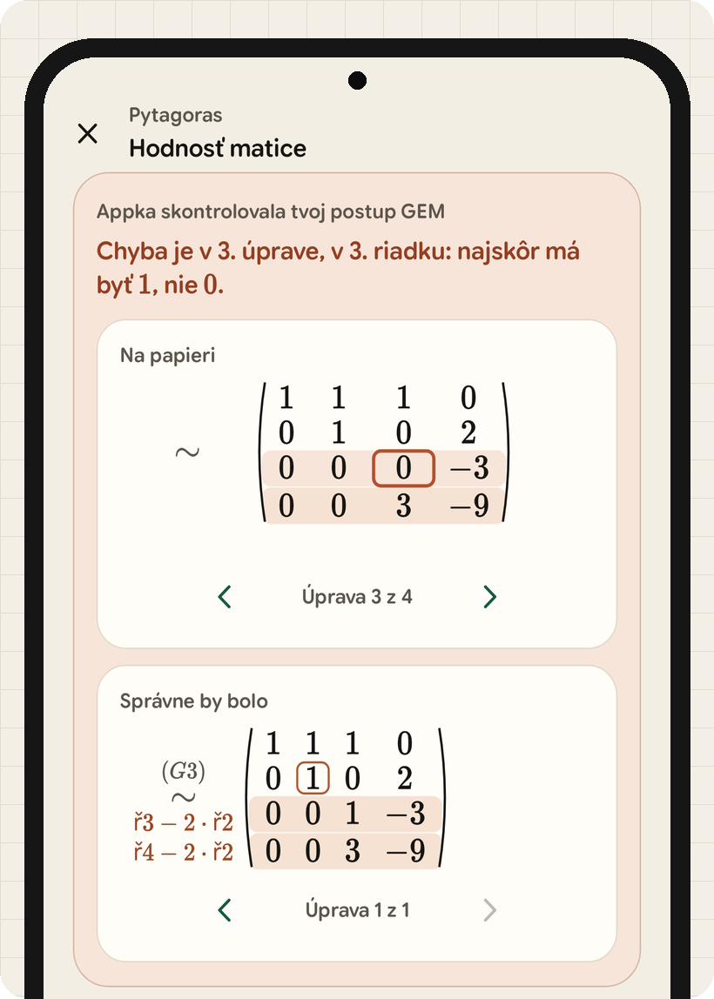
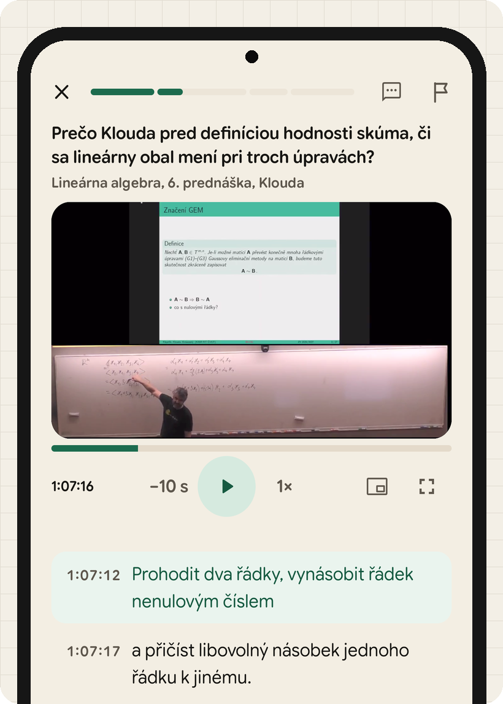

# FITagoras

**Pochop LA1 a DML medzi prednáškami.** Appka na Lineární algebru 1 a Diskrétní matematiku a logiku na FIT ČVUT,
pre Android aj iPhone, zadarmo.

<p>
<picture>
  <source media="(prefers-color-scheme: dark)" srcset="docs/zabery/tutor-tmava.png">
  
</picture>
<picture>
  <source media="(prefers-color-scheme: dark)" srcset="docs/zabery/klip-tmava.png">
  
</picture>
</p>

- **Pytagoras.** Odfotíš svoje riešenie z papiera a dozvieš sa, či by ti ho cvičiaci uznal a čo opraviť. Je to AI
  pomocník: beží cez tvoj účet ChatGPT a míňa limit tvojho plánu.
- **Lekcia.** Tá istá látka ako na prednáške, v krátkych lekciách, v ktorých hneď sám počítaš. Kúsok prednášky,
  kde to prednášajúci vysvetľuje, máš priamo v lekcii.
- **Opakovanie.** Čo ti nešlo, sa vráti, kým to nevieš.
- **Test.** Vieš, čo na teste býva a za koľko bodov, a skutočný test z minulých rokov si napíšeš celý nanečisto, na čas.

**[Stiahnuť pre Android](https://fitagoras.hamper.dev/?zariadenie=android)** (Android 13 a novší) ·
**[Otvoriť na iPhone](https://fitagoras.hamper.dev/app/)** (v Safari, iOS 18.2 a novší) ·
[fitagoras.hamper.dev](https://fitagoras.hamper.dev)

Neoficiálna appka, fakulta ju nevydáva ani nekontroluje. Vytvoril [Teodor Barča](https://teodorbarca.com).

## Inštalácia

**Android:** appka nie je v Google Play. V mobile otvor [stránku](https://fitagoras.hamper.dev/?zariadenie=android),
stiahni súbor a otvor ho; Android sa spýta, či môže prehliadač inštalovať aplikácie, daj Povoliť. Nové verzie appka
ponúkne sama a postup ostane.

**iPhone:** [webová verzia](https://fitagoras.hamper.dev/app/) v Safari. Cez Zdieľať a Pridať na plochu ju máš ako
appku; bez toho Safari zmaže postup po 7 dňoch bez návštevy. Klipy z prednášok hrajú ako v appke (celá obrazovka je
prehrávač Safari) a postup si prenesieš zálohou v Nastaveniach.

## Čo appka posiela

Appka pre Android posiela štatistiky o učení pod náhodným číslom inštalácie, bez mena, e-mailu a účtu; vypneš ich
v Nastaveniach (Súkromie). Čo pošleš Pytagorovi, ide cez tvoj účet ChatGPT priamo do OpenAI, nie autorovi. Presne, čo a kam ide,
je v [docs/SUKROMIE.md](docs/SUKROMIE.md).

## Odkiaľ je obsah

Z podkladov predmetov BI-LA1 a BI-DML: definície a vety doslova zo skrípt, klipy s titulkami zo záznamov prednášok
a úlohy zo starých písomiek a testov. Tieto texty a záznamy patria ich autorom. Čísla v príkladoch počíta a kontroluje
appka sama. Chybu v obsahu nahlásiš priamo v appke pre Android: pri každom kroku a úlohe je vpravo hore ikona
vlajky.

## Vývoj

Kotlin a Compose Multiplatform: jeden kód pre appku na Android, webovú verziu (Kotlin/Wasm) a JVM, na ktorom bežia
testy a zábery obrazoviek bez emulátora. Treba JDK 21 a Android SDK (compileSdk 37).

```sh
./gradlew :shared:jvmTest :app:assembleDebug   # testy a ladiace APK
scripts/web.sh                                 # webová verzia do build/web/
```

APK bude v `app/build/outputs/apk/debug/`, priečinok `build/web/` pustíš ľubovoľným statickým serverom.

Bez ďalších súborov sa appka zostaví, len sa neprehrajú klipy z prednášok a neposielajú sa štatistiky ani hlásenia
chýb. Na to treba kľúč k serveru klipov v `secrets.properties` v koreni repozitára (mimo gitu, šablóna je
`secrets.properties.example`; webová verzia má vlastný kľúč `clipsWebToken`). Podpísaná verzia (`./gradlew :app:assembleRelease`) potrebuje navyše podpisový kľúč,
pozri [docs/VYVOJ.md](docs/VYVOJ.md).

Počas práce púšťaj testy toho, čo meníš (`./gradlew :shared:jvmTest --tests '*.PapersTest'`), celú sadu raz pred
odovzdaním. Obrazovku si pozrieš bez emulátora:
`./gradlew :app:snap -Psnap.route=lesson:<id lekcie>:<krok> -Psnap.out=<priečinok>`.

Obsah sú dáta v kóde: predmet sa skladá z tém a nová látka je nový súbor témy v
`shared/src/commonMain/kotlin/dev/hamper/tabula/data/` (`dml/`, `la1/`). Pred zmenou obsahu si prečítaj
[docs/ZASADY.md](docs/ZASADY.md) a balík predmetu v `kurz/`; celý postup je v [CONTRIBUTING.md](CONTRIBUTING.md).

Kde čo nájdeš:

- [docs/KMP.md](docs/KMP.md): kde je ktorý kód, pravidlá pre spoločný kód, webová verzia;
- [docs/VYVOJ.md](docs/VYVOJ.md): obsah ako dáta, klipy, kľúče a vydanie;
- [docs/SYSTEM.md](docs/SYSTEM.md): ako sa appka overuje, zábery obrazoviek, tvorba obsahu;
- [docs/TUTOR.md](docs/TUTOR.md): Pytagoras, AI pomocník cez ChatGPT;
- [docs/ZASADY.md](docs/ZASADY.md) a [docs/CONTENT.md](docs/CONTENT.md): ako sa píše a pridáva obsah.

## Licencia

[GPL-3.0](LICENSE). Písma, ikony a logo OpenAI majú vlastné licencie a pôvod v [licenses/](licenses/).
